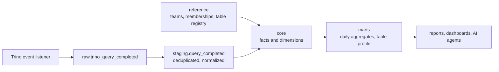
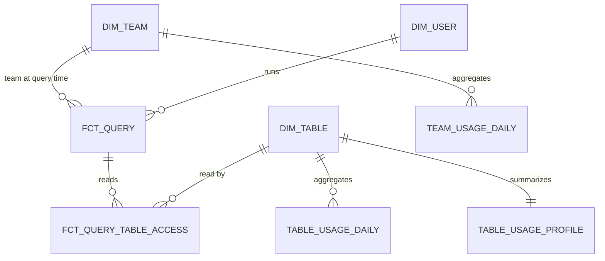

# Trino Usage Meta DWH

A metadata warehouse that turns raw Trino query events into historical usage
statistics for Iceberg tables. It answers questions such as:

- How many distinct users queried table X during a period?
- How many resources did team Y consume during that period?
- How is usage changing week over week, which tables drive compute cost, and
  which tables are unused, unregistered or undocumented?

Everything runs locally with Docker: Trino, an Iceberg REST catalog and
S3-compatible object storage, plus a Python pipeline that builds the warehouse
from realistic synthetic events and validates it with data quality checks.

## Quick start

Requirements: Docker with Compose v2.

```bash
docker compose up -d --wait trino            # object storage, Iceberg REST catalog, Trino
docker compose run --rm --build pipeline demo
```

`demo` creates all tables, loads one month of synthetic query events, builds every
layer, runs the data quality checks and prints the example queries. Excerpt:

```text
PASS         01_fct_query_unique_query_id
PASS         02_staging_complete
PASS         03_cost_allocation_reconciles
PASS         04_team_mart_reconciles
PASS         05_membership_no_overlaps
PASS         06_no_missing_keys

== 01_distinct_users_of_table ==
table_fqn                            distinct_users_exact  distinct_users_hll  query_count
iceberg.product_events.ide_sessions  15                    15                  2452

== 02_team_resource_usage ==
team_id            queries  failed_queries  distinct_users  cpu_hours  tib_scanned  memory_gib_hours  max_peak_memory_gib
product-analytics  3674     105             6               57.01      11.281       5.33              12.01
```

Other commands:

```bash
docker compose run --rm pipeline run --date 2026-10-31 --lookback-days 3   # scheduled daily run
docker compose run --rm pipeline run --start 2026-10-01 --end 2026-10-31   # backfill a range
docker compose run --rm pipeline check --start 2026-10-01 --end 2026-10-31
docker compose run --rm pipeline query --list
docker compose run --rm pipeline query 01_distinct_users_of_table --param table_fqn=iceberg.finance.invoices
```

Trino is also reachable at `localhost:8080` for ad-hoc SQL, e.g.
`docker compose exec trino trino`.

## Architecture



| Layer | Purpose | Refresh |
|---|---|---|
| `raw` | Query completed events as delivered: append-only, may contain duplicates and late arrivals | Written by the event listener |
| `reference` | Data Trino does not have: teams, user-to-team history, table ownership and descriptions | Synced from the directory and data catalog |
| `staging` | One row per query: duplicates removed, users and table names normalized | Incremental, by date partition |
| `core` | Star schema with facts at query and query-table grain | Facts incremental; dimensions full refresh |
| `marts` | Pre-aggregated daily usage and a per-table usage profile | Daily aggregates incremental; profile full refresh |

All tables are Iceberg tables in the `iceberg` catalog. Facts and aggregates are
partitioned by date.

## Data model



| Table | Grain | Key columns |
|---|---|---|
| `core.fct_query` | One row per query | `query_id`; `user_name`, `team_id`; CPU, wall, queued time, memory, bytes read |
| `core.fct_query_table_access` | One row per (query, table read) | `query_id`, `table_fqn`; columns read, bytes read, allocation weight, allocated CPU |
| `core.dim_team` | One row per team | `team_id`, `cost_center` |
| `core.dim_user` | One row per user | `user_name`, `account_type`, `current_team_id` |
| `core.dim_table` | One row per table, registered or observed | `table_fqn`, owner, domain, description, PII flag, first and last read date |
| `marts.table_usage_daily` | One row per (date, table) | queries, distinct users, HLL sketch of users, bytes, allocated CPU |
| `marts.team_usage_daily` | One row per (date, team) | queries, distinct users, HLL sketch of users, CPU, wall, memory, bytes |
| `marts.table_usage_profile` | One row per table | 30-day usage, top teams, top columns, usage status |

Every table and column carries a `COMMENT` in its DDL (`sql/ddl`), so the meaning of
each field is stored with the data and can be read through `SHOW CREATE TABLE` or
`information_schema`.

## Answering the questions

**Distinct users of table X in a period** — [`sql/queries/01_distinct_users_of_table.sql`](sql/queries/01_distinct_users_of_table.sql)

```sql
-- Exact: scans the access fact for the period
SELECT count(DISTINCT user_name)
FROM iceberg.core.fct_query_table_access
WHERE table_fqn = 'iceberg.product_events.ide_sessions'
  AND query_date BETWEEN DATE '2026-10-01' AND DATE '2026-10-31';

-- Approximate: merges one small sketch per day
SELECT cardinality(merge(CAST(users_hll AS HyperLogLog)))
FROM iceberg.marts.table_usage_daily
WHERE table_fqn = 'iceberg.product_events.ide_sessions'
  AND usage_date BETWEEN DATE '2026-10-01' AND DATE '2026-10-31';
```

**Resources consumed by team Y in a period** — [`sql/queries/02_team_resource_usage.sql`](sql/queries/02_team_resource_usage.sql)

```sql
SELECT
    sum(cpu_time_ms) / 3.6E6                                    AS cpu_hours,
    sum(physical_input_bytes) / power(1024, 4)                  AS tib_scanned,
    sum(cumulative_memory) / power(1024, 3) / 3.6E6             AS memory_gib_hours,
    max(max_peak_memory_bytes)                                  AS max_peak_memory_bytes
FROM iceberg.marts.team_usage_daily
WHERE team_id = 'product-analytics'
  AND usage_date BETWEEN DATE '2026-10-01' AND DATE '2026-10-31';
```

Further examples: weekly trend per team (`03`), tables ranked by compute cost (`04`)
and catalog health findings (`05`).

## Design decisions

### 1. Two fact tables instead of one

A query can read several tables, so there is no single grain that serves both
questions. `fct_query` holds one row per query and is the source of truth for
resource consumption; summing it never double counts. `fct_query_table_access`
holds one row per table read and answers table-level questions. Joining the two
through `query_id` gives both views without duplicating cost.

### 2. Cost of multi-table queries

If a query reads three tables and uses 10 CPU seconds, assigning 10 seconds to each
table would report 30 seconds in total. Instead, each table receives a share of the
query cost proportional to the bytes the query read from it:

```
allocation_weight = bytes_read(table) / bytes_read(all tables in the query)
cpu_time_ms_allocated = cpu_time_ms * allocation_weight
```

Bytes read are the best per-table cost signal Trino exposes. When no input reports
bytes the cost is split evenly. Weights always sum to 1, which is enforced by
check `03_cost_allocation_reconciles`. If the same table is scanned several times
(self-joins), the scans are merged into one row and `scan_count` records how many.
Team-level totals come from `fct_query` and are therefore unaffected by allocation.

### 3. Users and teams

Trino only knows the user name. Team membership comes from the company directory
and is stored as a type 2 history (`reference.user_team_membership`, with
`valid_from` / `valid_to`). Each query is assigned the team the user belonged to
when the query was created, so history does not change when someone moves teams.
Users missing from the directory are kept under the `unassigned` team instead of
being dropped, which keeps totals complete and makes gaps in the directory visible.
Service accounts (Airflow, BI tools, agents) are owned by a team like any other
user and are flagged with `account_type = 'service'`.

### 4. Resource metrics

| Metric | Source field | Additive | Use |
|---|---|---|---|
| CPU time | `cpu_time_ms` | Yes | Primary cost driver, chargeback |
| Bytes read | `physical_input_bytes` | Yes | Storage scan volume and S3 request cost |
| Cumulative memory | `cumulative_memory` | Yes | Memory reserved over time (GiB-hours) |
| Peak memory | `peak_user_memory_bytes` | No, take the maximum | Capacity planning, memory limit tuning |
| Wall time | `wall_time_ms` | Yes, as a total | Latency experienced by users |
| Queued time | `queued_time_ms` | Yes, as a total | Cluster saturation |
| Query count, failures | `query_state`, `error_code` | Yes | Adoption and reliability |

Failed queries are kept: they still consume resources. CPU hours can be converted to
money with a price per CPU hour if needed.

### 5. Distinct counts over arbitrary periods

Distinct users are not additive: summing daily distinct users over a week counts a
person once per day. The daily marts store the exact daily value and also a
HyperLogLog sketch of users (`approx_set`). Sketches can be merged across any range
of days, so weekly, monthly or custom-period distinct counts are answered from one
small row per day. Trino's default HLL has a standard error of about 1.6%. When an
exact number is required, the query runs on `fct_query_table_access`, which is
partitioned by date so the scan is limited to the requested period.

### 6. Incremental updates, late events and backfills

- Every incremental step deletes and rebuilds the date partitions in its window, so
  running the same window twice yields the same result. Backfills and
  recalculations after a logic change are the same command over a longer range.
- Events arrive at least once and can arrive late. Staging keeps the latest copy of
  each `query_id`. The scheduled daily run (`--date D --lookback-days 3`) reprocesses
  the last few days so that late events are picked up.
- Long ranges are processed in chunks (`--chunk-days`, default 7) to bound the size
  of each statement.
- Small dimensions and the usage profile are rebuilt in full on each run.
- Running `demo` again over the same data reproduces identical results.

### 7. Data quality checks

`sql/checks` contains checks that return the number of violating rows; the pipeline
fails if any is not zero:

| Check | Guards against |
|---|---|
| `01_fct_query_unique_query_id` | Duplicate events reaching the facts |
| `02_staging_complete` | Events lost between raw, staging and core |
| `03_cost_allocation_reconciles` | Allocated cost not adding up to the query cost |
| `04_team_mart_reconciles` | Marts drifting from the facts |
| `05_membership_no_overlaps` | Overlapping memberships fanning out the team join |
| `06_no_missing_keys` | Facts without a valid team or table |

### 8. Metadata for people and AI agents

The warehouse also describes the tables it monitors. `marts.table_usage_profile`
combines registry metadata (owner, domain, description, PII flag) with observed
usage (users, top teams, most read columns, trend) and classifies each table as
`active`, `declining`, `dormant` or `never_used`. A person or an AI agent looking for
data can find the right table, know whether it is maintained and see which columns
others use. The same table surfaces catalog gaps: unregistered tables in use, unused
tables and missing descriptions (query `05`).

## Assumptions

- **Event source.** The raw table holds one row per `QueryCompletedEvent` from the
  Trino event listener (for example the HTTP or Kafka listener), flattened into
  columns. Field names mirror the event: `QueryMetadata` (query id, state, query
  text), `QueryContext` (user, source), `QueryStatistics` (CPU, wall, queued time,
  memory, bytes) and `QueryIOMetadata` (inputs with catalog, schema, table, columns
  and physical input bytes, and the output table). Only completed events are needed;
  created and split events in other raw tables are not used.
- **Delivery.** At-least-once and possibly late. `query_id` identifies a query.
- **Time.** All timestamps are UTC and a query belongs to the date it was created.
- **Tables.** Inputs in the event are already resolved to fully qualified names, so
  no SQL parsing is needed. Names are lower-cased to merge different spellings.
  Views are attributed to the underlying tables that Trino actually reads.
- **Users and teams.** The directory provides user-to-team history; a user belongs
  to one team at a time. Unknown users map to `unassigned`.
- **Query text.** It may contain sensitive literals, so the core layer keeps a hash of
  the normalized text (to group repeated queries) rather than the text itself.

## Additional metadata required

| Table | Structure | Used for |
|---|---|---|
| `reference.teams` | `team_id`, `team_name`, `cost_center` | Team names, chargeback |
| `reference.user_team_membership` | `user_name`, `account_type`, `team_id`, `valid_from`, `valid_to` | Point-in-time team of each query |
| `reference.table_registry` | `table_fqn`, `owner_team_id`, `domain`, `description`, `contains_pii` | Ownership, documentation and the usage profile |

A price per CPU hour and per TiB scanned would be a natural addition for
converting resources into cost.

## Production considerations

- Schedule `run --date {{ ds }} --lookback-days 3` daily in the orchestrator and run
  `check` after it as a gate.
- Rebuilds use `DELETE` followed by `INSERT`, which are separate Iceberg commits.
  Readers could briefly see an empty partition; `MERGE` on the fact keys, or writing
  to a branch and publishing it, would make each step atomic.
- Schedule Iceberg maintenance (`optimize`, `expire_snapshots`,
  `remove_orphan_files`) for the frequently rewritten partitions.
- At larger volumes, partition raw by hour and the facts by day with a sort order on
  `table_fqn` and `team_id`.
- In the demo, events are written through Trino `INSERT` statements; in production
  the event listener writes them directly.

## Repository layout

```
docker-compose.yml        Local stack: object storage, Iceberg REST catalog, Trino, pipeline
trino/catalog/            Trino Iceberg catalog configuration
sql/ddl/                  Schemas and tables with column comments
sql/transform/incremental Partition-rebuilding steps for a date window
sql/transform/full        Dimensions and profile rebuilt on every run
sql/checks/               Data quality checks
sql/queries/              Example analytical queries
metadwh/                  Pipeline runner and CLI
metadwh/demo/             Synthetic event generator and reference data
tests/                    Unit tests
```

Unit tests run without Trino:

```bash
python -m unittest discover -s tests -t .
```
