# Trino Usage Meta DWH

[](https://github.com/alexSerranoR/trino-usage-meta-dwh/actions/workflows/ci.yml)


A metadata warehouse that turns raw Trino query events into **historical usage
statistics for Iceberg tables**: who reads which tables, how much compute each team
consumes, how that changes over time, and which tables are unused, undocumented or
expensive.

It runs end to end on a laptop with Docker, builds itself from realistic synthetic
events, and in **live mode** ingests the real query events of the bundled Trino, so
the warehouse monitors the cluster it runs on.

| Question | Answered by | Example result (demo data, October 2026) |
|---|---|---|
| How many distinct users queried table X? | `fct_query_table_access`, or merged HLL sketches | `ide_sessions`: 15 users, 2,017 queries |
| How many resources did team Y consume? | `marts.team_usage_daily` | `product-analytics`: 3,594 queries, 50.96 CPU hours, 11.05 TiB scanned |
| How is usage changing? | Weekly trends from the daily marts | CPU and users per team, week over week |
| Which tables drive cost? | CPU allocated to each table | `feature_usage` is the most expensive table |
| Which tables are unused or undocumented? | `marts.table_usage_profile` | 2 never-used tables, 1 unregistered table in use |
| Which repeated queries should become a dataset? | Query fingerprints | A single agent query pattern costs 16 CPU hours a month |

## Contents

- [Quick start](#quick-start)
- [How it works](#how-it-works)
- [Data model](#data-model)
- [Answering the questions](#answering-the-questions)
- [Design decisions](#design-decisions)
- [Live mode: real Trino events](#live-mode-real-trino-events)
- [Assumptions and additional metadata](#assumptions-and-additional-metadata)
- [Production considerations](#production-considerations)
- [Reference: CLI, layout, tests](#reference-cli-layout-tests)

---

## Quick start

Requirements: Docker with Compose v2.

```bash
docker compose up -d --wait trino               # object storage, Iceberg REST catalog, Trino
docker compose run --rm --build pipeline demo   # build, verify and query the warehouse
```

`demo` walks through the full lifecycle of the warehouse:

```mermaid
flowchart LR
    A[Create schemas<br/>and tables] --> B[Load reference data<br/>and 1 month of events]
    B --> C[plan: 31 dates<br/>not built]
    C --> D[sync: build<br/>all layers]
    D --> E[6 quality<br/>checks pass]
    E --> F[59 late events<br/>arrive for 15 Oct]
    F --> G[plan: only<br/>15 Oct is stale]
    G --> H[sync rebuilds<br/>one day]
    H --> I[maintain:<br/>compact files]
    I --> J[Print example<br/>queries]
```

<details>
<summary>Demo output (excerpt)</summary>

```text
== Initial build ==
Plan: 31 date(s) to rebuild
  not_built      31 date(s), 2026-10-01 .. 2026-10-31
...
PASS         01_fct_query_unique_query_id
PASS         02_staging_complete
PASS         03_cost_allocation_reconciles
PASS         04_team_mart_reconciles
PASS         05_membership_no_overlaps
PASS         06_no_missing_keys

== Late events arrive for one past day ==
Loaded 59 late events for 2026-10-15
Plan: 1 date(s) to rebuild
  2026-10-15  new_events     470 raw events
...
Plan: everything is up to date

== Table maintenance ==
iceberg.raw.trino_query_completed    102           31
...

== 01_distinct_users_of_table ==
table_fqn                            distinct_users_exact  distinct_users_hll  query_count
iceberg.product_events.ide_sessions  15                    15                  2017

== 02_team_resource_usage ==
team_id            queries  failed_queries  distinct_users  cpu_hours  tib_scanned  memory_gib_hours  max_peak_memory_gib
product-analytics  3594     120             6               50.96      11.054       4.75              12.02
```

</details>

Trino is available at `localhost:8080` for ad-hoc SQL (`docker compose exec trino trino`).
The full list of commands is in the [CLI reference](#cli).

---

## How it works

### System overview

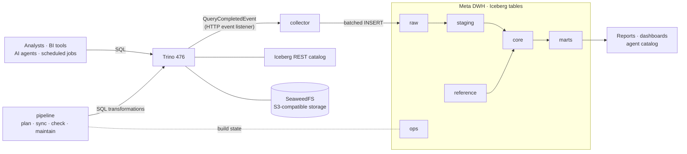

The pipeline never moves data out of the warehouse: every transformation is a SQL
statement executed by Trino over Iceberg tables. Python only orchestrates, plans and
validates.

### Layers

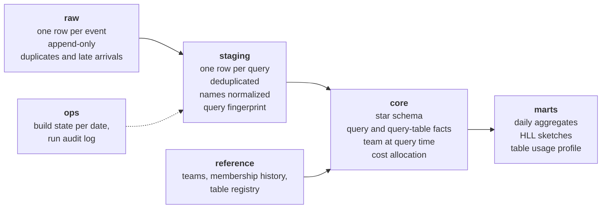

| Layer | Purpose | Refresh |
|---|---|---|
| `raw` | Query completed events as delivered: append-only, may contain duplicates and late arrivals | Written by the collector |
| `reference` | Data Trino does not have: teams, user-to-team history, table ownership and descriptions | Synced from the directory and the data catalog |
| `staging` | One row per query: duplicates removed, users and table names normalized | Incremental, by date partition |
| `core` | Star schema with facts at query and query-table grain | Facts incremental; dimensions full refresh |
| `marts` | Pre-aggregated daily usage and a per-table usage profile | Daily aggregates incremental; profile full refresh |
| `ops` | Build state of every date and an audit log of pipeline runs | Written by the pipeline |

### One pipeline run

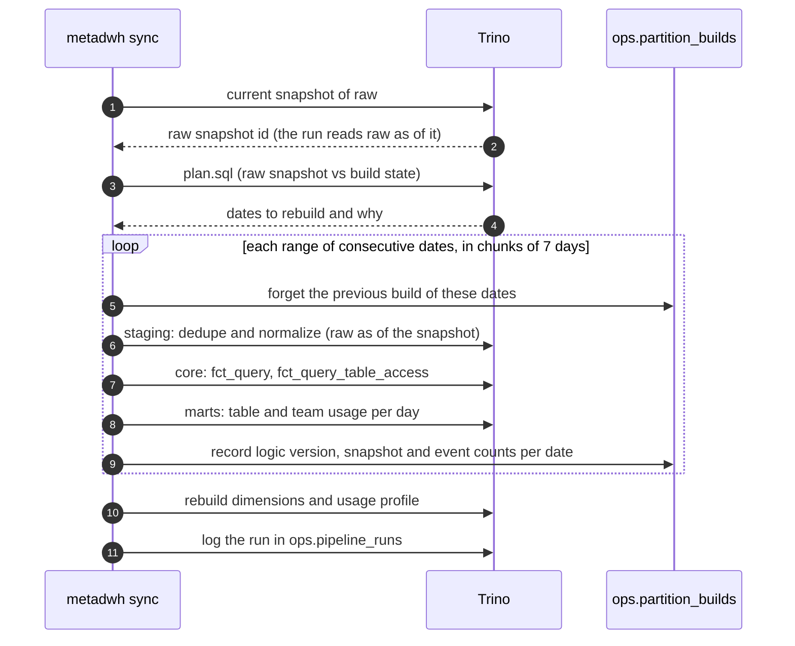

---

## Data model

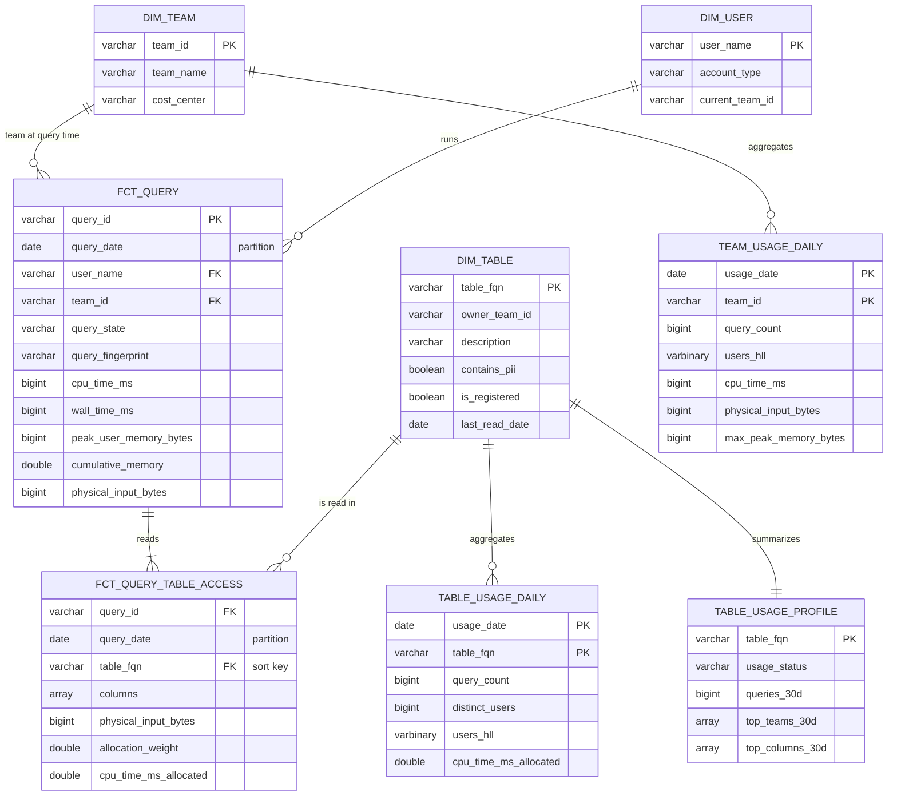

| Table | Grain | Key columns |
|---|---|---|
| `core.fct_query` | One row per query | `query_id`; user, team; CPU, wall, queued time, memory, bytes read |
| `core.fct_query_table_access` | One row per (query, table read) | `query_id`, `table_fqn`; columns read, bytes read, allocation weight, allocated CPU |
| `core.dim_team` | One row per team | `team_id`, `cost_center` |
| `core.dim_user` | One row per user | `user_name`, `account_type`, `current_team_id` |
| `core.dim_table` | One row per table, registered or observed | `table_fqn`, owner, domain, description, PII flag, first and last read date |
| `marts.table_usage_daily` | One row per (date, table) | queries, distinct users, HLL sketch of users, bytes, allocated CPU |
| `marts.team_usage_daily` | One row per (date, team) | queries, distinct users, HLL sketch of users, CPU, wall, memory, bytes |
| `marts.table_usage_profile` | One row per table | 30-day usage, top teams, top columns, usage status |
| `ops.partition_builds` | One row per date | logic version, latest raw event and event count included in the build |
| `ops.pipeline_runs` | One row per run | command, window, status, duration, error |

The consumer-facing tables in `core`, `marts` and `ops` carry `COMMENT`s on the table
and its key columns ([`sql/ddl`](sql/ddl)), so their meaning is stored with the data
and readable through `SHOW CREATE TABLE` or `information_schema`; the agent catalog
exports them.

---

## Answering the questions

### How many distinct users queried table X during a period?

[`sql/queries/01_distinct_users_of_table.sql`](sql/queries/01_distinct_users_of_table.sql)
returns both an exact and an approximate answer:

```sql
-- Exact: reads the access fact, pruned to the period's partitions
SELECT count(DISTINCT user_name)
FROM iceberg.core.fct_query_table_access
WHERE table_fqn = 'iceberg.product_events.ide_sessions'
  AND query_date BETWEEN DATE '2026-10-01' AND DATE '2026-10-31';

-- Approximate: merges one small HyperLogLog sketch per day
SELECT cardinality(merge(CAST(users_hll AS HyperLogLog)))
FROM iceberg.marts.table_usage_daily
WHERE table_fqn = 'iceberg.product_events.ide_sessions'
  AND usage_date BETWEEN DATE '2026-10-01' AND DATE '2026-10-31';
```

### How many resources did team Y consume during that period?

[`sql/queries/02_team_resource_usage.sql`](sql/queries/02_team_resource_usage.sql)
sums the daily team mart, which is additive:

```sql
SELECT
    sum(cpu_time_ms) / 3.6E6                            AS cpu_hours,
    sum(physical_input_bytes) / power(1024, 4)          AS tib_scanned,
    sum(cumulative_memory) / power(1024, 3) / 3.6E6     AS memory_gib_hours,
    max(max_peak_memory_bytes)                          AS max_peak_memory_bytes,
    cardinality(merge(CAST(users_hll AS HyperLogLog)))  AS distinct_users
FROM iceberg.marts.team_usage_daily
WHERE team_id = 'product-analytics'
  AND usage_date BETWEEN DATE '2026-10-01' AND DATE '2026-10-31';
```

### Further questions

| Query | Question |
|---|---|
| [`03_team_weekly_trend`](sql/queries/03_team_weekly_trend.sql) | How do CPU and users per team change week over week? Flags partial weeks. |
| [`04_top_tables_by_cost`](sql/queries/04_top_tables_by_cost.sql) | Which tables drive compute cost, and how many people read them? |
| [`05_table_catalog_health`](sql/queries/05_table_catalog_health.sql) | Which tables are unused, unregistered or missing a description? |
| [`06_repeated_query_patterns`](sql/queries/06_repeated_query_patterns.sql) | Which recurring query patterns, including scheduled jobs, cost the most and should be pre-computed? |
| [`07_table_writers`](sql/queries/07_table_writers.sql) | Who writes table X, and what does producing it cost? |

---

## Design decisions

### 1. Two fact tables instead of one

A query can read several tables, so no single grain answers both questions. Resource
consumption lives at query grain; table usage lives at query-table grain.

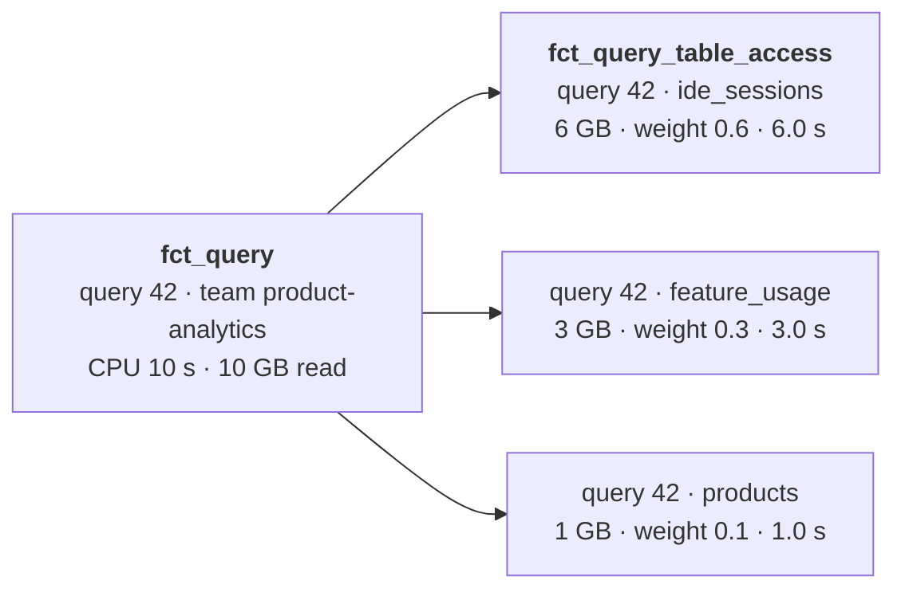

`fct_query` is the source of truth for cost; summing it never double counts.
`fct_query_table_access` answers table-level questions. `query_id` joins them.

### 2. Cost of multi-table queries

Giving the full 10 CPU seconds to each of three tables would report 30 seconds for a
10-second query. Each table instead receives a share proportional to the bytes the
query read from it:

```
allocation_weight      = bytes_read(table) / bytes_read(all tables in the query)
cpu_time_ms_allocated  = cpu_time_ms × allocation_weight
```

| Table read by query 42 | Bytes read | Weight | CPU allocated |
|---|---:|---:|---:|
| `ide_sessions` | 6 GB | 0.6 | 6.0 s |
| `feature_usage` | 3 GB | 0.3 | 3.0 s |
| `products` | 1 GB | 0.1 | 1.0 s |
| **Total** | **10 GB** | **1.0** | **10.0 s** |

- Bytes read are the best per-table cost signal the event exposes. If any input of a
  query does not report bytes, proportional shares would give it nothing, so that
  query's cost is split evenly instead.
- Reads of Trino's own metadata (the `system` catalog and `information_schema`) are
  not data tables and are left out of the access fact.
- Weights always sum to 1, enforced by check `03_cost_allocation_reconciles`.
- A table scanned several times in one query (self-joins) is merged into one row;
  `scan_count` records how many scans.
- Team totals come from `fct_query`, so they never depend on the allocation.

### 3. Users and teams: team at query time

Trino only knows the user name. Teams come from the company directory, stored as a
type 2 history with `valid_from` / `valid_to`. Each query is assigned the team the
user belonged to **when the query ran**, so history does not change when someone
moves. In the demo, `maria.lopez` moves from marketing to product on 15 October:

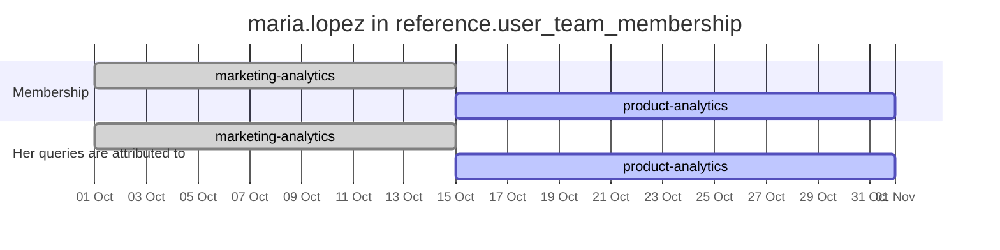

Marketing's weekly distinct users drop from 3 to 2 after she moves and product's rise
from 5 to 6, while October's first two weeks stay with marketing.

- Users missing from the directory go to an `unassigned` team instead of being
  dropped, which keeps totals complete and makes directory gaps visible.
- Service accounts (Airflow, BI tools, agents) belong to a team like anyone else and
  are flagged with `account_type = 'service'`.
- User names are normalized (trimmed, lower-cased) on both sides of the join.
- Check `05_membership_no_overlaps` rejects overlapping periods, duplicated rows and
  empty periods, so the point-in-time join cannot duplicate queries.
- Teams removed from the directory stay in `dim_team` while they have history, so
  past usage never loses its team.

### 4. Resource metrics

| Metric | Source field | Additive | Use |
|---|---|---|---|
| CPU time | `cpu_time_ms` | Yes | Primary cost driver, chargeback |
| Bytes read | `physical_input_bytes` | Yes | Scan volume and S3 request cost |
| Cumulative memory | `cumulative_memory` | Yes | Memory reserved over time (GiB-hours) |
| Peak memory | `peak_user_memory_bytes` | **No**, take the maximum | Capacity planning, memory limits |
| Wall time | `wall_time_ms` | Yes, as a total | Latency experienced by users |
| Queued time | `queued_time_ms` | Yes, as a total | Cluster saturation |
| Queries, failures | `query_state`, `error_code` | Yes | Adoption and reliability |

Failed queries are kept because they still consume resources. CPU hours can be
priced per hour if a cost in money is needed.

### 5. Distinct counts over any period

Distinct users are not additive. Summing daily values counts the same person once
per day:

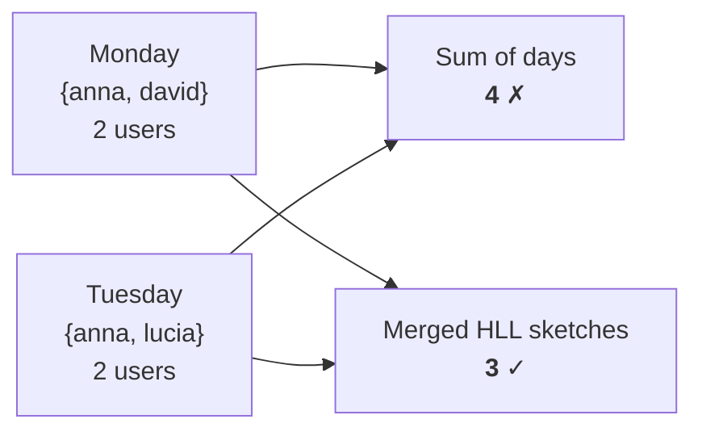

The daily marts store the exact daily count and a HyperLogLog sketch of users
(`approx_set`). Sketches merge across any range, so weekly, monthly or custom-period
counts read one small row per day. The standard error is about 1.6%; when an exact
figure is required, the query runs on the access fact, pruned to the period.

### 6. Incremental updates, late events and recalculations

Every step rebuilds whole date partitions, so re-running a window gives the same
result. On top of that, the pipeline **decides by itself which dates need work**
instead of reprocessing a fixed look-back window. `ops.partition_builds` records, for
every date, the logic version it was built with and the raw events it included;
`plan` compares that with raw:

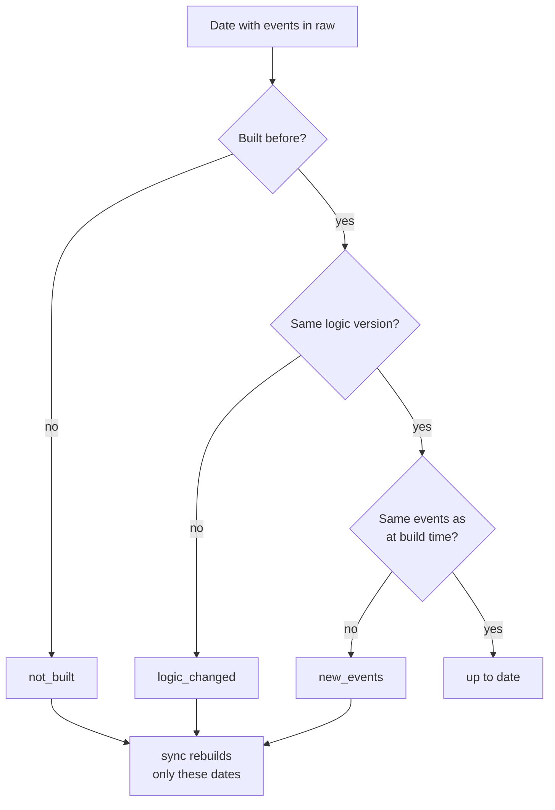

| Reason | Meaning | Typical cause |
|---|---|---|
| `not_built` | Raw has events for a date that was never built | First run, new day |
| `new_events` | Events arrived after the date was built | Late or redelivered events |
| `logic_changed` | The transformation logic changed since the build | New requirement, bug fix |

- **Late events** rebuild only the days they belong to, however late they arrive. In
  the demo, 59 events for 15 October arrive after the build and only that day is
  rebuilt.
- **Logic changes** are detected automatically. The logic version is a hash of the
  incremental SQL with comments and whitespace removed, so a real change marks every
  date as `logic_changed` while a reworded comment does not. A recalculation after a
  requirement change is a single `sync`, and `plan` shows its scope first.
- **One raw snapshot per run.** At the start, the run takes the current Iceberg
  snapshot of raw and every step (plan, staging, the build record) reads raw
  `FOR VERSION AS OF` that snapshot. Events committed meanwhile are not half-processed;
  they make the next `plan` report `new_events`.
- **Failures cannot hide.** A run forgets the build record of its dates before
  rebuilding them, so if a step fails half-way the dates show up as `not_built`
  rather than as up to date.
- **Backfills** of any range use `run --start --end`, processed in chunks
  (`--chunk-days`, default 7) to bound each statement.
- **Audit.** Every run is logged in `ops.pipeline_runs` with status, duration and error.

### 7. Query performance and storage layout

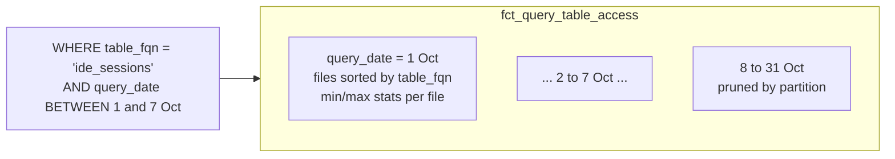

- **Partitioning by date** prunes every partition outside the requested period.
- **Sort order within partitions** (`table_fqn` for table access and table usage,
  `team_id` and `user_name` for queries, `team_id` for team usage) lets Iceberg's per-file min/max statistics
  skip files that cannot match a table or team filter.
- **HLL sketches** answer period distinct counts from one row per day.
- **Maintenance.** `maintain` compacts small files and expires old snapshots and
  orphan files. Raw receives many small appends; in the demo it goes from 102 files
  to 31, one per day.
- **Cheap planning.** The planner reads only `create_time` and `ingested_at` from raw.

### 8. Repeated query patterns

Staging fingerprints each statement after removing comments (BI tools add tracking
comments), replacing string and numeric literals and collapsing `IN` lists of any
length, so the same dashboard, agent or scheduled query run with different
parameters shares one value:

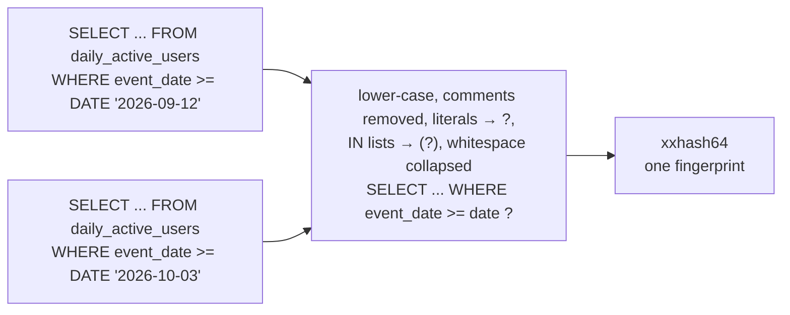

Query `06` ranks recurring patterns by total CPU with the users, teams and tables
involved. In the demo, one agent pattern runs 160 times and costs 16 CPU hours a
month over four tables: a clear candidate for a reusable, pre-computed dataset. Core
and marts keep only the fingerprint, not the query text, which may contain sensitive
literals; the text stays in raw only (see assumptions on retention).

### 9. Data quality checks

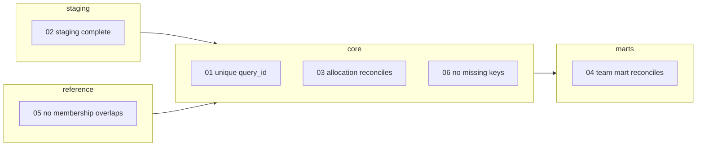

| Check | Guards against |
|---|---|
| `01_fct_query_unique_query_id` | Duplicate events reaching the facts |
| `02_staging_complete` | Events lost or duplicated between the raw snapshot each date was built from, staging and core |
| `03_cost_allocation_reconciles` | Allocated cost not adding up to the query cost |
| `04_team_mart_reconciles` | Marts drifting from the facts |
| `05_membership_no_overlaps` | Overlapping, duplicated or empty memberships fanning out the team join |
| `06_no_missing_keys` | Facts without a valid team or table |

Each check returns the number of violating rows; `check` fails if any is not zero.

### 10. Metadata for people and AI agents

The warehouse also describes the tables it monitors, so people and agents can find
the right data, know whether it is maintained and see how others use it.

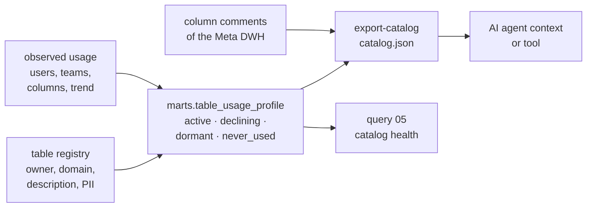

`export-catalog` writes one JSON document. For every monitored table it lists the
description, owner, domain, PII flag, usage status, users, top teams and columns
ranked by how often they are read, plus explicit warnings. It also documents the Meta
DWH's own tables from their column comments, so an agent can query usage directly.

```json
{
  "table": "iceberg.analytics.legacy_dau_v1",
  "description": "Deprecated first version of daily active users. Superseded by daily_active_users.",
  "owner_team": "product-analytics",
  "usage": {"status": "never_used", "queries_30d": 0, "distinct_users_30d": 0},
  "columns_by_usage": [],
  "warnings": ["Not used recently; may be deprecated."]
}
```

---

## Live mode: real Trino events

```bash
export COMPOSE_FILE=docker-compose.yml:docker-compose.live.yml
# PowerShell: $env:COMPOSE_FILE = "docker-compose.yml;docker-compose.live.yml"
docker compose up -d --build --wait
docker compose run --rm pipeline init
docker compose exec trino trino --user anna.petrova --execute "SELECT count(*) FROM iceberg.core.fct_query"
docker compose run --rm pipeline sync
```

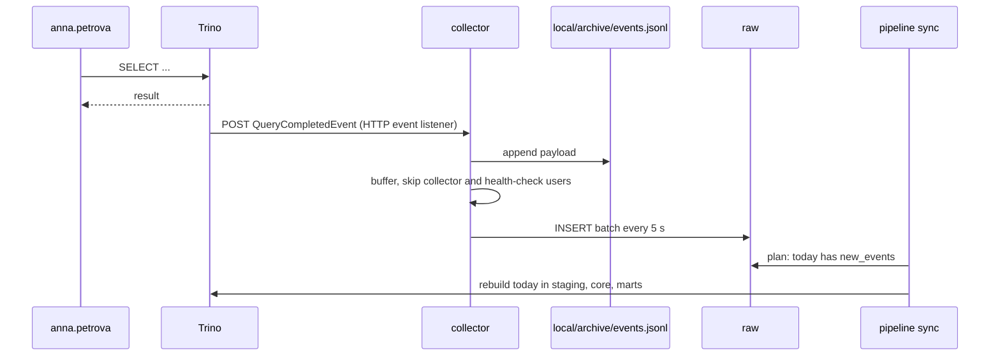

- **No feedback loop.** The collector's own `INSERT`s and the container health checks
  are ignored. The pipeline's queries are kept, so the warehouse also reports its own
  cost; as a result the current day always has new events, as expected for a day
  that is not over.
- **Recoverable writes.** Every accepted payload is archived before it is buffered.
  Batches are bounded in size to stay under Trino's statement limit; a batch that
  keeps failing is dropped after three attempts and can be recovered with
  `docker compose exec collector metadwh replay /archive/events.jsonl`. Staging
  deduplicates by `query_id`, so replays are safe, and unreadable lines are skipped.
  Events Trino cannot deliver while the collector is down are lost after the
  listener's retries; the Kafka listener would make delivery durable.
- **Validated against real payloads.** The parser is tested with events captured
  from Trino 476 ([`tests/fixtures`](tests/fixtures)). Capturing them revealed that
  Trino 476 serializes durations as decimal seconds (`"0.757000000"`), which the
  tests now cover.
- **CI** sends a real query in live mode on every push and checks that it reaches
  `fct_query`.

---

## Assumptions and additional metadata

### Assumptions

| Topic | Assumption |
|---|---|
| Event source | One row per `QueryCompletedEvent` from the Trino event listener (HTTP in live mode; Kafka works the same way), flattened into columns that mirror `QueryMetadata`, `QueryContext`, `QueryStatistics` and `QueryIOMetadata`. Only completed events are used. |
| Delivery | At least once, possibly late. `query_id` identifies a query. |
| Time | All timestamps are UTC; a query belongs to the date it was created. |
| Tables | Event inputs are already resolved to fully qualified names, so no SQL parsing is needed. Names are lower-cased to merge spellings. Views are attributed to the underlying tables Trino reads. |
| Multiple sources | A query reading several tables gets one access row per table and its cost is split by bytes read (decision 2). |
| Users and teams | The directory provides user-to-team history; a user belongs to one team at a time. Unknown users map to `unassigned`. |
| Query text | May contain sensitive literals. Core and marts keep only its fingerprint; raw keeps the text as delivered and should get a retention policy (or masking) separate from the rest of raw. |
| Retention | Raw is the source of truth for rebuilds and is retained; expiring it would make older dates impossible to recalculate. |
| Clusters | One cluster. With several, the event's `environment` would be added to the key, since `query_id` is only unique per cluster. |
| Not yet used | The event also carries `principal` (impersonation), `groups` and the resource group, which could map users to teams without a directory, and the snapshot id of each table read, which would show data freshness. |

### Additional metadata required

| Table | Structure | Used for |
|---|---|---|
| `reference.teams` | `team_id`, `team_name`, `cost_center` | Team names, chargeback |
| `reference.user_team_membership` | `user_name`, `account_type`, `team_id`, `valid_from`, `valid_to` | Point-in-time team of each query |
| `reference.table_registry` | `table_fqn`, `owner_team_id`, `domain`, `description`, `contains_pii` | Ownership, documentation, usage profile, agent catalog |

A price per CPU hour and per TiB scanned would be the natural next addition, to turn
resources into cost.

---

## Production considerations

- **Scheduling.** Run `sync` hourly or daily in the orchestrator, `check` after it as a
  gate, and `maintain` daily.
- **Atomic rebuilds.** Rebuilds are a `DELETE` followed by an `INSERT`, two Iceberg
  commits; readers could briefly see an empty partition. `MERGE` on the fact keys, or
  writing to an Iceberg branch and publishing it, would make each step atomic.
- **Concurrency.** Two `sync` runs, or `maintain` during a `sync`, should not overlap;
  the orchestrator's single-instance scheduling or a lock row in `ops` would enforce it.
- **Time zone.** Days are UTC. Teams working in European time would get a local
  calendar column for reporting, without changing partitions.
- **Planner at scale.** The planner could read per-partition statistics from Iceberg
  metadata tables instead of scanning two columns of raw, and raw could be
  partitioned by hour.
- **Ingestion at scale.** The collector writes through Trino, which is simple and
  enough for one cluster. With many clusters, the Kafka event listener and a
  streaming writer into Iceberg would decouple ingestion from the cluster being
  measured.

---

## Reference: CLI, layout, tests

### CLI

All commands run as `docker compose run --rm pipeline <command>`.

| Command | What it does |
|---|---|
| `demo` | End-to-end demonstration on synthetic events |
| `init` | Create schemas and tables (idempotent) |
| `seed` | Load demo reference data and synthetic raw events |
| `plan` | Show which dates are missing or stale, and why |
| `sync` | Rebuild exactly the dates reported by `plan` |
| `run --start D --end D` | Force a rebuild of a date range (backfill) |
| `check --start D --end D` | Run the data quality checks |
| `maintain` | Compact files, expire snapshots, remove orphan files |
| `query NAME [--param k=v]` | Run an example query from `sql/queries` |
| `export-catalog --output /local/catalog.json` | Write the catalog for AI agents |
| `late-events --date D --count N` | Simulate delayed delivery for a past day |
| `collect` / `replay FILE` | Receive live events / reload an archive (collector) |

`run` also accepts `--date D --lookback-days N` for orchestrators that pass a run date;
scheduled runs should prefer `sync`, which needs no look-back window.

### Repository layout

```
.
├── docker-compose.yml          Object storage, Iceberg REST catalog, Trino, pipeline
├── docker-compose.live.yml     Live mode: event listener and collector
├── trino/                      Trino catalog and live-mode listener configuration
├── sql/
│   ├── ddl/                    Schemas and tables, with column comments
│   ├── transform/incremental/  Partition-rebuilding steps for a date window
│   ├── transform/full/         Dimensions and profile, rebuilt on every run
│   ├── ops/                    Build planner and build state
│   ├── checks/                 Data quality checks
│   └── queries/                Example analytical queries
├── metadwh/
│   ├── pipeline.py             Planning, incremental runs, maintenance, checks
│   ├── collector.py            HTTP receiver for Trino query events
│   ├── catalog.py              Agent catalog export
│   ├── raw_events.py           Raw event model and SQL rendering
│   ├── cli.py                  Command-line interface
│   └── demo/                   Synthetic event generator and reference data
└── tests/                      Unit tests and captured Trino payloads
```

### Tests and CI

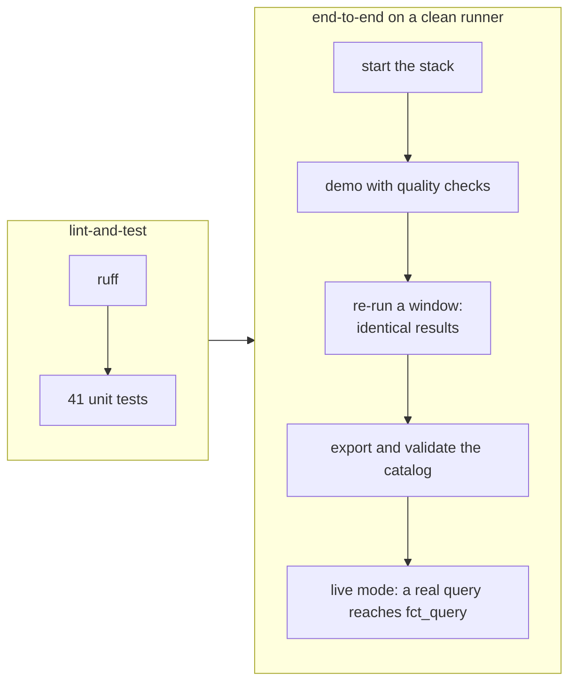

Unit tests run without Trino:

```bash
python -m unittest discover -s tests -t .
```
